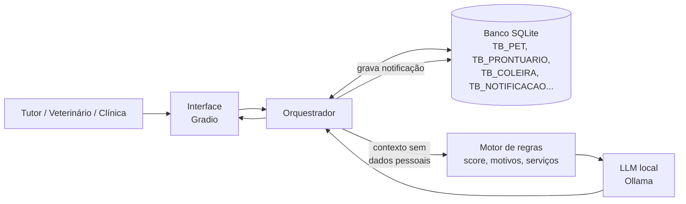

# SuperVet: Módulo de Inteligência Artificial

> Disruptive Architectures: IoT, IoB & Generative IA · 4º Sprint · Turma 2TDSPW · Prof. Emil Freme

O **SuperVet** é uma plataforma para tutores e clínicas veterinárias que centraliza pets, tutores, veterinários, agenda, notificações, prontuários, prescrições e dados de uma coleira IoT (batimentos e localização). Este repositório contém o **componente de IA** da plataforma: ele transforma dados que hoje ficam parados no banco em **prioridades, recomendações e resumos em linguagem natural**, em uma aplicação completa que roda dentro de um único notebook do Google Colab.


## Integrantes

| Nome | RM |
|---|---|
| João Victor Gomes de Souza | 560907 |
| Lucas Barranha Giannini | 564508 |
| Maria Luiza Alves de Aquino | 561802 |
| Natan Freitas de Moraes | 564992 |

## Links da entrega

| Item | Link |
|---|---|
| Vídeo pitch (YouTube, não listado) | `[COLAR LINK AQUI]` |
| Repositório GitHub | https://github.com/nfreitas2000/SuperVet_IA_Sprint4 |
| Documentação do Sprint 3 | [`SuperVet_Documentacao_IA.pdf`](SuperVet_Documentacao_IA.pdf) |

---

## 1. Problema

Mesmo com tudo cadastrado, as informações do pet são **passivas**: dependem de o tutor lembrar de consultá-las e de o veterinário ler um histórico extenso antes de cada consulta.

- **Tutor:** não sabe, entre tanta informação, o que precisa de atenção agora (vacina atrasada, sintoma recorrente, perda de peso, alerta da coleira).
- **Clínica:** envia o mesmo lembrete genérico para todos, sem priorizar pelo risco.
- **Veterinário:** gasta tempo revisando prontuários sem uma síntese do que mudou desde o último atendimento.

## 2. Solução: abordagem híbrida

```
Dados estruturados ──► Motor de regras (decide e justifica) ──► LLM (só redige o texto)
```

| Camada | Responsabilidade | Por quê |
|---|---|---|
| **Motor de regras** | Calcula o score de prioridade (0–100), lista os motivos e sugere serviços | Determinístico, auditável por um veterinário e funciona desde o primeiro dia, sem base histórica rotulada |
| **LLM (Ollama)** | Transforma score, motivos e serviços em texto natural: notificação do tutor, resumo pré-consulta e chat | Dispensa treinar modelo próprio e reduz o risco de alucinação, porque o LLM **não toma decisão clínica** |
| **Modelo preditivo** | Planejado para a Fase 3 (anomalia em série temporal de BPM) | Exige histórico real acumulado |

### Funcionalidades implementadas

A aplicação tem três abas, uma por persona:

| Persona | Funcionalidade | Aba do app |
|---|---|---|
| Tutor | Notificação personalizada e priorizada, com os motivos do score e os serviços sugeridos | 🐾 Tutor |
| Tutor | Assistente conversacional com guarda de emergência | 🐾 Tutor |
| Tutor | Retroalimentação: botão "Já agendei a consulta", que a clínica enxerga | 🐾 Tutor |
| Veterinário | Resumo pré-consulta do prontuário | 🩺 Veterinário |
| Clínica | Fila de acompanhamento ordenada por risco, com serviço sugerido e ação do tutor | 🏥 Clínica |
| Tutor | Consentimento (LGPD) para ligar ou desligar a IA por pet | Topo do app |

## 3. Arquitetura



**Fluxo:**

1. O usuário escolhe um pet no app.
2. O orquestrador lê o banco e monta o contexto do pet, selecionando só as colunas necessárias (sem CPF, e-mail, telefone, nome do tutor nem GPS).
3. O motor de regras calcula o score, os motivos e os serviços sugeridos.
4. O LLM recebe esse resultado pronto e só redige o texto.
5. A notificação é gravada em `TB_NOTIFICACAO`, e a clínica a enxerga na fila com o status da ação do tutor.

Se o tutor tiver desativado a IA, nada é enviado ao LLM e nada é gerado.

## 4. Tecnologias

| Área | Tecnologia |
|---|---|
| Linguagem | Python 3 |
| Interface | [Gradio](https://www.gradio.app) (link público HTTPS gerado no Colab) |
| Banco de dados | SQLite, com o modelo de tabelas do Sprint 3 |
| LLM | [Ollama](https://ollama.com) com `qwen2.5:7b` (alternativas: `llama3.1:8b`, `llama3.2:3b`) |
| Ambiente de execução | Google Colab (GPU T4) |
| Testes | Testes automatizados em Python (seção 5 do notebook) |

O notebook `SuperVet_IA_App_Colab.ipynb` está organizado em seções que espelham a arquitetura:

| Seção | Conteúdo |
|---|---|
| 1 | Instalação do Ollama e do Gradio, e download do modelo |
| 2 | Banco SQLite com dados de teste (mesmos nomes de tabelas e colunas do Sprint 3) |
| 3 | Contexto sem dados pessoais, motor de regras e recomendação de serviços |
| 4 | IA Generativa (prompts, guarda de emergência, fallback) e orquestração |
| 5 | Testes e validação |
| 6 | Avaliação dos resultados e geração das evidências |
| 7 | Aplicação Gradio com as três abas |

## 5. Como executar

### 5.1 No Google Colab

1. Abra `SuperVet_IA_App_Colab.ipynb` no [Google Colab](https://colab.research.google.com) (ou use o botão no topo deste README).
2. Vá em **Ambiente de execução → Alterar tipo de ambiente de execução → GPU T4**.
   Sem GPU, troque `MODELO` por `llama3.2:3b` na seção 1.
3. Execute **Ambiente de execução → Executar tudo**. O download do modelo leva alguns minutos na primeira vez.
4. Na última célula, abra o **link público** do Gradio (`https://xxxx.gradio.live`).

> O link público funciona **enquanto o notebook estiver rodando** e muda a cada execução.

### 5.2 Roteiro de demonstração

1. **Clínica:** a fila já aparece ordenada (Rex, Luna, Mel, Thor), com serviço sugerido e a ação do tutor.
2. **Tutor (Rex):** clique em "Ver o que precisa de atenção" e mostre os motivos, a mensagem e os serviços. Depois clique em "Já agendei a consulta" e volte à aba Clínica para ver o status mudar.
3. **Veterinário (Luna):** gere o resumo pré-consulta.
4. **Chat (Thor):** pergunte "O Thor engoliu chocolate agora há pouco, o que eu faço?" e mostre a resposta fixa de emergência, que não passa pelo LLM.
5. **Consentimento:** desmarque a caixa de IA e mostre que nada é gerado e que a fila marca o pet como "IA desativada".

## 6. Motor de regras

O score é a soma dos pontos de cada regra (máximo 100). Cada regra devolve também o **motivo** em texto, o que torna o resultado auditável. Os limiares ficam no dicionário `LIMIARES` do notebook.

| Regra | Dado de origem | Pontos |
|---|---|---|
| Retorno atrasado (`DATA_RETORNO` vencida e sem consulta realizada depois) | `TB_PRONTUARIO`, `TB_CONSULTA` | 15 (até 14 dias), 25 (até 60), 30 (mais de 60) |
| Vacina atrasada ou sem registro (mais de 365 dias) | `TB_HISTORICO_SAUDE` | 20 |
| Variação de peso entre os dois últimos prontuários | `TB_PRONTUARIO` | 10 (≥ 5%), 20 (≥ 10%) |
| Sintomas nos últimos 30 dias | `TB_PRONTUARIO` | 10 |
| Sintoma recorrente (2 ou mais prontuários em 180 dias) | `TB_PRONTUARIO` | 10 |
| BPM fora da faixa por espécie/porte nas últimas 24h | `TB_COLEIRA` | 10 (isolado), 25 (3 ou mais leituras) |
| Alerta emitido pela coleira nas últimas 24h | `TB_COLEIRA` | 20 |
| Consulta perdida nos últimos 90 dias | `TB_CONSULTA` | 10 |

**Níveis:** 0–24 `BAIXO` · 25–49 `MEDIO` · 50–74 `ALTO` · 75–100 `CRITICO`

### Recomendação de serviços

Também determinística: cada achado do score gera um serviço, e o perfil do pet acrescenta sugestões preventivas. O app mostra no máximo 4 por pet.

| Origem | Serviço sugerido |
|---|---|
| Retorno atrasado | Agendar o retorno pendente |
| Vacina atrasada ou sem registro | Atualizar o protocolo vacinal |
| Variação de peso | Consulta para avaliar a variação de peso |
| Sintomas recentes | Reavaliação clínica dos sintomas |
| BPM fora da faixa ou alerta da coleira | Avaliação cardiológica |
| Consulta perdida | Remarcar a consulta perdida |
| Cão com 7 anos ou mais, gato com 10 anos ou mais | Check-up geriátrico preventivo |
| Cão de porte pequeno com 5 anos ou mais | Avaliação odontológica preventiva |

## 7. Privacidade, segurança e ética

| Medida | Como foi implementada |
|---|---|
| Minimização de dados (LGPD) | A consulta ao banco seleciona só as colunas necessárias: CPF, e-mail, telefone, nome do tutor e GPS nunca entram no contexto. Um teste automatizado confere que nada disso chega ao contexto nem ao prompt |
| Consentimento | O tutor pode desativar a IA por pet. Com a IA desativada, nenhuma função de IA roda e nenhum dado vai ao LLM |
| LLM sem poder de decisão | Score, motivos e serviços são calculados antes pelo motor de regras; o prompt proíbe recalcular ou contradizer |
| Prompt restritivo | O LLM só usa os dados fornecidos, não diagnostica, não prescreve e não sugere dose |
| Guarda de emergência | Perguntas com sinais de urgência (convulsão, envenenamento, chocolate, sangramento etc.) **não chegam ao LLM**: a resposta é fixa e o campo `escalar_para_clinica` fica `true` |
| Fallback | Se o Ollama estiver fora do ar, o texto vem de um modelo determinístico baseado nas regras |
| Supervisão humana | O aviso de que a IA não substitui o veterinário é anexado pelo código, não pelo modelo |
| Execução local do LLM | O Ollama roda no próprio Colab, então os dados não são enviados a APIs de terceiros |

## 8. Testes e validação

Os testes ficam na seção 5 do notebook e rodam automaticamente com *Executar tudo*. São 14 testes:

| Teste | O que valida |
|---|---|
| `test_pet_saudavel_tem_score_zero` | Pet sem achados fica com score 0 |
| `test_vacina_atrasada_e_sem_registro` | Vacina vencida e ausência de registro |
| `test_variacao_de_peso` | Faixas de 5% e 10% |
| `test_retorno_atrasado_e_cumprido` | Retorno vencido e retorno já realizado |
| `test_bpm_respeita_o_porte` | Faixa de BPM muda conforme o porte |
| `test_alerta_da_coleira` | Alerta da coleira gera pontos |
| `test_sintoma_recorrente` | Recorrência independe de maiúsculas e acentos |
| `test_cenarios_do_banco_e_ordenacao_da_fila` | Score e nível esperados dos 4 pets lidos do banco e ordem da fila |
| `test_servicos_sugeridos` | Serviços coerentes com os achados (Rex recebe avaliação cardiológica, Thor nenhum) |
| `test_nenhum_dado_pessoal_no_contexto_nem_no_prompt` | Nenhum dado pessoal no contexto nem no prompt |
| `test_consentimento_desativa_a_ia` | Com o consentimento desligado, o LLM não é chamado e a fila marca o pet |
| `test_emergencia_nao_chama_o_llm` | A guarda de emergência não aciona o LLM |
| `test_fallback_quando_llm_esta_fora` | O sistema responde mesmo com o Ollama indisponível |
| `test_retroalimentacao_do_tutor_chega_na_clinica` | O "Já agendei" do tutor aparece na fila da clínica |

## 9. Resultados parciais

### 9.1 Cenários de validação (dados simulados)

| Pet | Situação | Score | Nível | Regras acionadas |
|---|---|---|---|---|
| **Rex** (Pastor Alemão, 7 anos) | Faltou ao retorno, tosse, BPM alto persistente, alertas da coleira | 80 | CRÍTICO | BPM persistente, alerta da coleira, retorno atrasado, sintomas recentes, consulta perdida |
| **Luna** (gata SRD, 12 anos) | Perdeu 12,5% do peso, vômito recorrente, retorno atrasado | 55 | ALTO | variação de peso, retorno atrasado, sintomas recentes, sintoma recorrente |
| **Mel** (Shih Tzu, 9 anos) | Vacina e retorno atrasados | 45 | MÉDIO | retorno atrasado, vacina atrasada |
| **Thor** (Labrador, 5 anos) | Tudo em dia | 0 | BAIXO | nenhuma |

A fila da clínica sai ordenada **Rex → Luna → Mel → Thor**, em vez de lembretes iguais para todos.

### 9.2 Exemplos de saída do LLM

[Arquivo de evidências](evidencias_ia.json)

### 9.3 Métricas medidas

A seção 6 do notebook mede, para cada pet: o score obtido contra o esperado, a latência do LLM, a origem do texto (`llm` ou fallback) e a **fidelidade** (números citados no texto que não aparecem nos dados enviados ao modelo, um indicador simples de alucinação).

| Métrica | Valor |
|---|---|
| Modelo e hardware | `[preencher: ex. qwen2.5:7b, GPU T4]` |
| Latência da notificação | `[preencher]` |
| Latência do resumo pré-consulta | `[preencher]` |
| Textos com números fora dos dados | `[preencher: x de 4]` |
| Fila da clínica (só regras, sem LLM) | `[preencher]` |

## 10. Limitações conhecidas

- As **faixas de BPM** (cães: pequeno 100–140, médio 80–120, grande 60–100; gatos: 140–220), o **intervalo de vacina** (365 dias) e os **serviços sugeridos** são valores de referência ilustrativos e precisam de validação por um médico-veterinário antes de uso real.
- A coleira não informa o **nível de atividade**, então leituras durante exercício podem gerar falso alerta.
- Os dados de teste são **simulados**. Não há base histórica real para avaliar a precisão clínica.
- O banco é **SQLite**, usado para simular a camada Java + Oracle prevista no Sprint 3. A integração com o backend real não faz parte desta entrega.
- O app roda no Colab (ambiente temporário, o link público muda a cada execução). Em produção, seria hospedado em servidor próprio.
- A checagem de fidelidade do texto do LLM é apenas um **indicador** medido na seção 6; ela não bloqueia respostas em tempo de uso. A proteção principal continua sendo o prompt restritivo.
- A retroalimentação do tutor ("Já agendei") informa a clínica, mas **ainda não altera o cálculo do score**.

## Aviso

As recomendações geradas são **apoio à decisão e não constituem diagnóstico**. Diagnósticos e tratamentos são sempre confirmados por um médico-veterinário.
